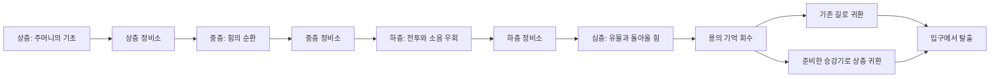

# V9.9 · 심층 원정과 세 번의 층간 정비

2026-11-07 Asia/Seoul. 기준 `e1c87bc`(V9.8). 새 원정의 목적은 **상층·중층·하층·심층을 거쳐 심층의 「용의 기억」을 회수하고 입구로 귀환하는 것**이다. 얕은 유물로 일찍 승리하는 구조는 새 원정에서 제거했다.

## 한 원정의 흐름



20개 방을 네 구역으로 연결했다. 상층 정비소5·중층 정비소7·하층 정비소13에서 준비를 마쳐야 다음 구역으로 내려갈 수 있다. 하층의 다른 입구를 통해 심층으로 들어가도 같은 준비 조건을 확인하므로 정비소를 우회해 건너뛸 수 없다. 맵의 방 테두리와 HUD의 구역 표시를 네 단계에 맞췄다.

| 구역 | 능력 풀을 쓰는 이유와 경로 선택 |
|---|---|
| 상층 | 보급함의 금화 또는 순찰병의 보상을 챙겨 첫 정비를 준비한다. |
| 중층 | 곧바로 정비소로 가거나 기억 창고·수비실에 들러 더 모은다. 새 능력이 주머니의 실제 순환에 들어간다. |
| 하층 | 파수병의 회랑과 이끼·침수 서가의 우회로를 비교한다. 선택한 이동 방식과 은신, 전투 능력에 따라 유리한 길이 달라진다. |
| 심층 | 봉인병과 승강기를 거치는 입구 또는 침수 서가 쪽 입구를 고른다. 비상 보급소에 들를 수도 있다. 최종 수호룡을 넘고 유물을 가져온다. |

## 정비는 풀 빌딩과 보급의 선택

정비소의 주인은 녹스다. 같은 인물의 원화·키포즈·초상을 사용하고, 준비 선택 뒤에는 기억을 맡기거나 내려놓거나 보급을 건네는 대화를 연결한다. 중층·하층의 기억함도 같은 녹스와 이어진다.

각 정비소에서 다음 **한 가지**를 선택한다.

- **새 기억 영입:** 세 후보 중 하나를 고른다. 상층은 불씨 화살·길잡이·침묵의 망토, 중층은 달빛 쌍검·공중제비·수호의 등불, 하층은 화염 일격·유령 걸음·새벽의 기도다. 새 메달은 식은 메달 더미에 들어가 다음 순환부터 추출된다. 현재 손의 공격력을 즉시 올리거나 새 손을 재추출하지 않는다.
- **기억 정리:** 메달 하나를 영구 제거해 필요한 능력이 다시 돌아오는 순환을 줄인다. 최소5개를 남긴다. 선택 중 저장·재개할 수 있고 취소하면 준비 기회를 쓰지 않는다. 실제 제거를 확정해야 다음 구역이 열린다.
- **보급 확보:** 체력 최대6 회복·경계2 감소·휴대 보급1개를 얻는다. 이미 남긴 방의 메아리는 지우지 않는다.

준비를 끝낸 정비소에서는 남은 기술로 **추가 교역을 한 번** 할 수 있다. 새 원정에서는 다른 방에서 교역을 열 수 없고, 정비소를 다시 방문하거나 턴을 넘겨도 준비·교역 횟수는 복구되지 않는다. 설명을 읽거나 준비 화면을 닫는 것은 선택을 소비하지 않는다.

휴대 보급은1개를 들고 출발하며, 턴마다 한 번 최대 체력6을 회복한다. 포장을 푸는 기본 소리3이 발생하고 실제 은신·첫 소음 수정치를 적용한다. 체력이 가득 차면 소모하지 않는다. 인벤토리는 원정 저장에 함께 남는다.

## 소음은 앞으로 갈 때와 돌아올 때 함께 관리한다

구역에 처음 들어갈수록 금고의 기억이 깊어진다. 메아리가1씩 옅어지는 간격은 상층1턴 → 중층2턴 → 하층3턴 → 심층4턴이다. 올라와도 이미 높아진 기억 단계는 줄어들지 않는다. 이동·전투·보급·승강기에서 낸 소리가 다음 턴과 귀환 경로에 영향을 준다.

심층 승강기17은 **기술3·기본 소리8**로 상층 정비소5에 연결된다. 상호작용을 마친 실제 통로로 이동·적의 추적·소리·숨결이 모두 통한다. 비용이나 RNG를 바꾸지 않고 예고만 보는 기존 소리·유인 지도도 유지했다. 유물 회수 후 귀환 제한14턴과3의 배수 턴 숨결은 이어진다.

새 원정 점수는 `유물56 + 귀환20 + 남은 체력 + max(0, 60−진행 턴) + max(0, 30−올림(실제 소음 합계÷3))`이다. 금화와 단순 방문 수를 반복해서 늘리는 것으로 점수를 얻지 않는다. 능력 풀의 크기는 결산에 보여 주지만 많이 모았다는 이유만으로 점수를 더하지 않는다. 준비한 풀을 효율적으로 써서 회수·귀환하는 행동을 보상한다.

## 이전 탐험과 회상

- **이미 저장한16방·이전20방 원정은 같은 맵과 규칙으로 계속한다.** 새 구조는 메뉴 → 새 탐험 → 시작으로 들어간다. 직업 선택을 취소하면 기존 진행을 유지하며, 최고 기록도 보존한다.
- 새 메인 원정만 `layout: staged`와 세 준비·추가 교역·휴대 보급 상태를 저장한다. 저장 버전은2를 유지하고 레이아웃별로 검증한다. 기존 엔진 호출의 기본 레이아웃은 호환을 위해 유지하며 게임의 새 탐험 버튼은 새 레이아웃을 명시한다.
- 18단계의 짧은 튜토리얼 회상은 별도 저장·시나리오·단계 키를 유지한다. 도입과 결산에서 실전은 네 구역과 심층 유물이라는 점을 설명한다. 첫 실전 준비도 같은 새 원정으로 연결한다. 회상 자체가 네 구역 전체를 가르치는 새 튜토리얼로 바뀐 것은 아니다.

## 검증

런타임27모듈 문법 검사와 **테스트112개 통과**. 새 검사는 정비 전 두 심층 입구 차단, 영입 후 현재 손 유지, 한 번만 선택·교역, 정리의 취소/확정/저장, 보급과 실제 소음 수정치, 승강기의 실제 추적/숨결 통로, 진행 상태 검증, 심층 유물 조건, 시간·소음 점수와 기존 맵 호환을 다룬다.

[브라우저 결과](V99-BROWSER-RESULTS.json), [규칙 재생 결과](V99-RULES-RESULTS.json), [대표 화면](../visual/implemented/v99/).

| 실제 Chromium 터치 경로 | 정비 선택 | 결과 |
|---|---|---|
| 360×640 · 기사 | 영입 → 정리 → 영입 | 심층 회수·승강기 귀환·탈출 PASS |
| 390×844 · 도적 | 영입 → 영입 → 영입 | 심층 회수·승강기 귀환·탈출 PASS |
| 740×320 · 마법사 | 보급 → 영입 → 영입 | 침수 서가 입구로 심층 회수·기존 길 귀환·탈출 PASS |

정비 직후 전달 컷신 중 새로고침, 미확정 정리 선택의 재개와 취소, 유물 회수 후 재개를 실제 조작으로 확인했다. 게임·RNG·저장을 주입하지 않았고 상태는 읽어서 비교했다. 각 실행은 서로 다른 실제 시작 시드를 사용했으므로 점수나 턴 차이를 경로 선택만의 효과로 해석하지 않는다.

별도로 기존 읽기 검수 도구를 현재 버전에서 실행해 360×640 회상 전체 완주·도감·키워드·원래 원정 보존을 확인했다. 명시적 복구 fixture로 이전 완료 회상과 미선택 보상을 복원하고 준비 취소·Escape도 확인했다. 또 다른 독립적인 이전 원정 fixture에서는 기존 맵이 로드되고 새 탐험을 취소하면 저장이 같으며, 시작을 누를 때만 네 구역 원정으로 바뀌는지 확인했다. fixture 결과를 정상 플레이와 구분한다.

세 직업×30시드의 엔진 재생은 실제 구매·준비·이동·전투·보급을 소비해 심층 귀환이 가능한지 확인했다. 정해진 경로와 맵을 아는 정책이며 사람의 난이도·승률이나 모든 풀 빌드의 균형을 측정한 자료가 아니다. 브라우저도 로컬 Chromium 화면/터치 에뮬레이션이며 실제 기기/Safari 검수와 구분한다.

```bash
npm run check
npm test
node docs/production/tools/verify-v99-rules.mjs
python3 -m http.server 8037 --bind 127.0.0.1 --directory .
# 별도 터미널: Python Playwright와 /usr/bin/chromium 필요
python3 docs/production/tools/verify-v99-expedition.py 360
python3 docs/production/tools/verify-v99-expedition.py 390
python3 docs/production/tools/verify-v99-expedition.py 740
python3 docs/production/tools/verify-v98-readability.py 360 --base-url http://127.0.0.1:8037
# 별도 컨텍스트에 명시적인 이전 저장 fixture를 생성·주입하는 호환 검사
python3 docs/production/tools/verify-v99-legacy.py
```
