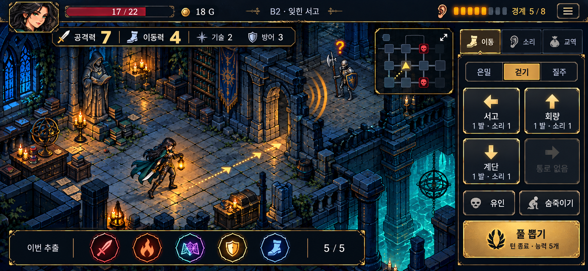
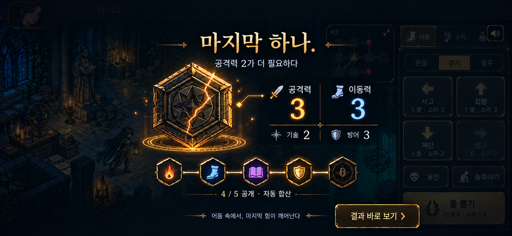

# 잿불 금고 — 확정 아트·UI 기준

확정일: 2026-10-27. 사용자가 탐험·풀 추출 목업의 품질을 승인했습니다. 이 두 이미지는 후속 제작의 시각적 기준입니다. 현재 실행 화면으로 표시하지 않습니다.

## 탐험 화면

## 마지막 능력 공개 직전

## 유지할 기준

- 휴대폰 가로 932×430을 주 기준으로, 740×320까지 페이지·내부 패널 스크롤 없이 조작한다. 버튼의 실제 터치 영역은 최소 44×44 CSS px를 목표로 검증한다. 목업 이미지 자체는 1846×852px이며 터치·반응형 검증을 대신하지 않는다.
- 공격력·이동력을 가장 큰 숫자로 표시한다. 기술·방어는 보조 정보다. 능력은 풀에서 추출되어 자동 합산되며 카드를 직접 끌어 쓰지 않는다.
- 청록·남색 석재와 금빛 등불, 명료한 픽셀 실루엣, 어두운 반투명 UI와 얇은 금속 테두리를 유지한다.
- 성인 여성 도적·기사·마법사의 미형 얼굴과 일관된 복장·무기·머리카락을 유지한다. 초상화와 게임 속 전신은 같은 인물이어야 한다.
- 우측 상단 미니맵은 던전 위에 항상 표시한다. 현재 위치·발견한 방·적·소리 경로를 구분하며 누르면 큰 소리 지도를 연다.
- 소음은 통로를 따라 전파되는 게임 상태를 시각화한다. 벽을 뚫는 임의의 원형 파동을 규칙처럼 보여주지 않는다.
- 우측 조작부는 이동·소리·교역 탭, 이동 방식, 최대 네 통로, 유인·숨죽이기, 고정 풀 뽑기 버튼으로 구성한다.
- 추출 중에는 확정된 최종 자원이나 미공개 토큰이 배경 HUD에 먼저 나타나지 않아야 한다. 지금까지 공개된 능력의 합계만 단계적으로 보여준다.
- 마지막 봉인은 정적·심장 박동·미세한 균열·공개 순간의 빛으로 강조한다. 결과 바로 보기는 연출만 건너뛰며 추첨 결과를 바꾸지 않는다.

## 제작 형태

목업 전체를 게임 화면 배경으로 붙이지 않는다. 바닥, 벽, 가구, 캐릭터, 효과, UI를 각각 제작하고 실제 상태로 합성한다. UI 텍스트·숫자·버튼은 코드로 표시한다.

목표 구도는 3/4 상단 시점이다. 기존의 방 단위 이동·자원 소비 규칙을 유지하면서 방 안 경유점 이동과 출입 연출을 구현한다. 자유 이동이나 실시간 전투로의 규칙 변경은 이 기준에 포함하지 않는다.

캐릭터는 N·NE·E·SE·S·SW·W·NW의 방향별 원화와 이동·공격 프레임을 사용한다. 비대칭 무기·방패·등불을 좌우 반전으로 대체하지 않는다. 이동은 발 접지·양발 교대, 공격은 준비·타격·복귀가 실제 포즈로 구별되어야 한다.

## 제작 전 상태

| 항목 | 현재 실행 코드 | 추가 작업 |
| --- | --- | --- |
| 풀·자원·교역·저장 | V4에서 작동 | 확정 UI로 스타일 변경 |
| 휴대폰 고정 화면 | V4에서 작동 | 새 레이아웃에서도 넘침·터치 재검증 |
| 소음·적 반응 | 방 그래프 규칙과 지도 존재 | 공간 파동·벽 가림·적 반응 효과 연결 |
| 미니맵 | 소리 지도 렌더러 존재 | 항상 보이는 반투명 오버레이 구현 |
| 캐릭터 | 단일 포즈 이미지에 변환 효과 | 8방향 걷기·공격 아틀라스 제작·연결 |
| 공간 | 정면 무대형 배경 4종 | 목표 시점에 맞는 모듈형 에셋 제작 |
| 추출 | 단계 공개·최종 정적·건너뛰기 존재 | 새 봉인 에셋·배경 최종 값 차단 확인 |

확정 이미지가 구현 완료의 근거는 아니다. 진행 상태는 [HANDOFF.md](../../HANDOFF.md)에 기록한다. 원본 프롬프트와 초안은 [GENERATION-PROMPTS.md](GENERATION-PROMPTS.md)에 보관한다.
