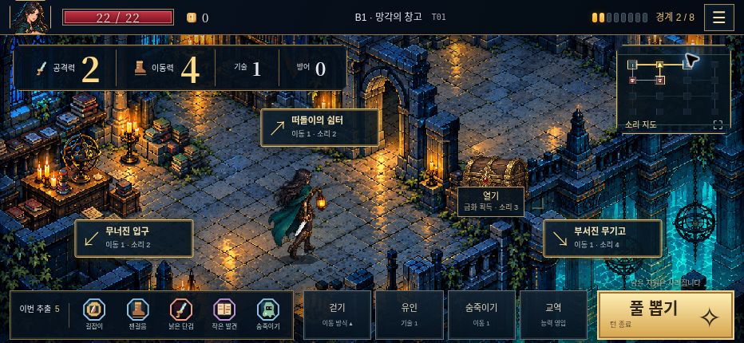
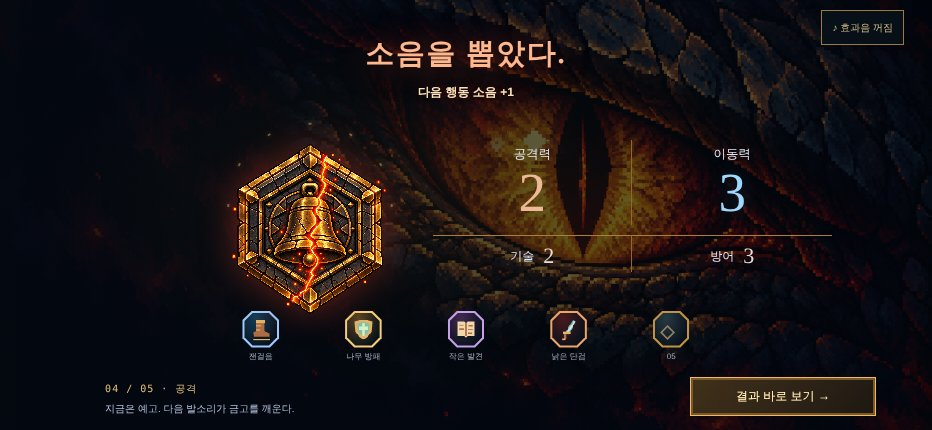
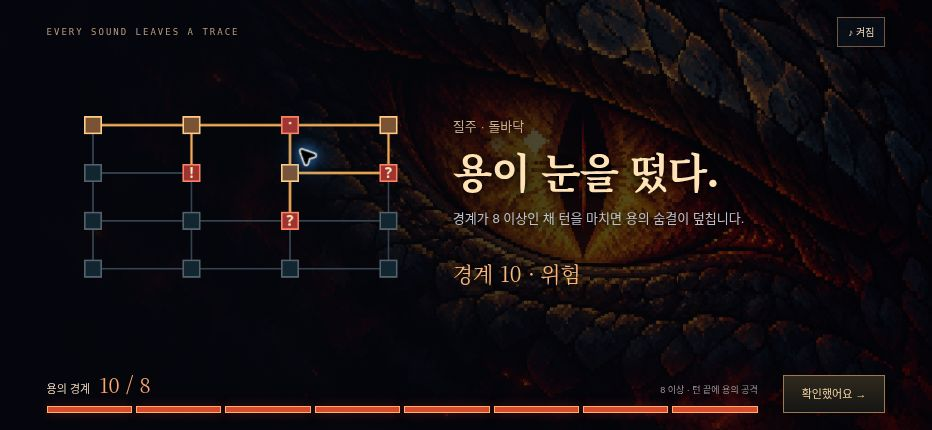
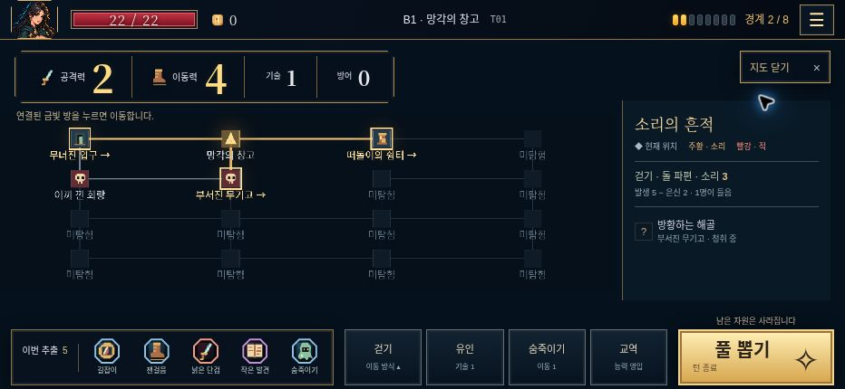
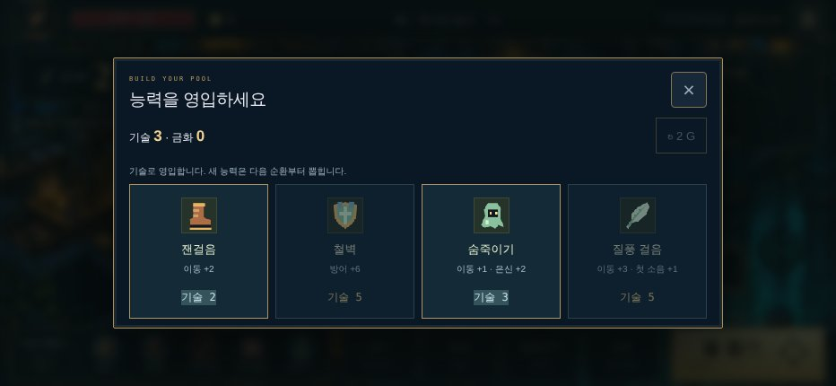
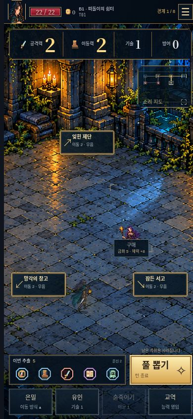

# 잿불 금고 · UI 시안 요청서 (레퍼런스 적용)

> 디자이너 전달용. 현재 V7 화면, 문제점, 참고할 게임 화면, 바꿀 방향을 화면별로 정리했다.
> 게임 규칙·수치·저장 형식은 바꾸지 않는다. 화면 배치와 시각 위계만 다룬다.

## 레퍼런스 사이트 사용법

| 사이트 | 쓰는 곳 | 찾는 법 |
|---|---|---|
| [Game UI Database](https://www.gameuidatabase.com/) | 화면별 1차 레퍼런스 | 게임 이름 검색 → 화면 종류 필터(HUD, 지도, 상점, 결과 등) |
| [Interface In Game](https://interfaceingame.com/) | 같은 게임의 다른 화면 보완 | 게임 이름 검색 |
| [ArtStation](https://www.artstation.com/) | 컨셉 시안 무드 | `dark fantasy game UI`, `pixel art UI` |
| [Lospec](https://lospec.com/palette-list) | 픽셀 팔레트 | 푸른 석재·금·청록 계열 팔레트 |

**저작권 원칙:** 레퍼런스는 구조와 위계만 참고한다. 그림·아이콘·프레임을 따오거나 그대로 따라 그리지 않는다. 시안마다 "무엇만 참고하는지"를 한 줄로 적는다.

## 공통 규칙 (모든 시안)

- **색:** 푸른 석재 배경, 금빛 강조, 청록 수로, 붉은 봉인(위험). 위험 = 붉은색만. 금빛은 "누를 수 있는 것"과 "핵심 자원"에만.
- **글자:** 한글 픽셀/비트맵 계열 1종 + 숫자용 세리프 1종(현재 공격력·이동력 숫자). 버튼 8자 이내, 안내 40자 이내.
- **크기:** 740×320(최소 가로), 932×430(기준), 390×844(세로) 세 크기 시안 필수. 터치 영역 최소 44×44px.
- **위계 3단:** ① 지금 결정해야 할 것(풀 뽑기, 이동 대상) ② 판단 근거(자원, 경계, 소음) ③ 참고 정보(로그, 지도 범례).

---

## 1. 탐험 화면 (메인 HUD)

**현재 문제**
- 게임의 핵심 긴장인 **용의 경계**가 우측 상단 점 8개로 작다. 체력 바도 작다.
- 하단 버튼 6개(이번 추출, 걷기, 유인, 숨죽이기, 교역, 풀 뽑기)가 비슷한 무게다. 풀 뽑기만 강조되고 나머지는 구분이 약하다.
- 방 이동 라벨과 상호작용 라벨(열기)이 같은 모양이라 이동인지 행동인지 한눈에 안 갈린다.

**참고**
- **Darkest Dungeon** (HUD): 상단 횃불 밝기 게이지, 스트레스 게이지. *게이지가 화면 분위기를 지배하는 방식만 참고.*
- **Loop Hero** (HUD): 픽셀 화면에서 많은 정보를 작은 패널로 정리하는 방식.
- **Hades** (HUD): 주 행동 1개만 크게, 나머지는 아이콘+키 표시로 작게.

**시안 방향**
1. 경계 게이지를 상단 중앙으로 옮기고 키운다. 경계가 오를수록 게이지 끝의 용의 눈이 열린다(0~7 감음, 8 이상 뜸).
2. 하단 보조 버튼(이동 방식, 유인, 숨죽이기, 교역)은 아이콘+짧은 글자로 줄인다. 풀 뽑기만 큰 버튼 유지.
3. 이동 라벨 = 화살표+방 이름(현재 유지). 상호작용 라벨 = 원형 아이콘 버튼으로 모양을 분리.

## 2. 풀 추출 (봉인 메달)

**현재 문제**
- 연출 완성도는 높다. 다만 자원 숫자가 바뀌는 순간의 쾌감이 약하다. 숫자가 그냥 바뀐다.
- 소음이 붙은 메달과 일반 메달의 구분이 공개 후에만 보인다.

**참고**
- **Balatro** (점수 계산): 숫자가 튀어 오르며 더해지는 카운트업. *숫자 연출 타이밍만 참고.*
- **Slay the Spire** (카드 보상): 공개된 항목을 나란히 비교하는 배치.

**시안 방향**
1. 메달이 열릴 때 해당 자원 숫자가 +N으로 튀어나와 합산되는 카운트업 연출.
2. 소음 메달은 공개 순간 테두리가 붉게 갈라지는 표시(현재 큰 봉인 연출은 유지, 하단 5칸 아이콘에도 같은 표시).
3. 마지막 봉인 직전 1.5초 정적은 유지.

## 3. 소음 · 용의 경계 연출

**현재 문제**
- 하단 8칸 경계 막대가 탐험 화면의 점 8개와 모양이 다르다. 같은 수치인데 두 가지 표현이다.
- 상단 영어 문구(EVERY SOUND LEAVES A TRACE)가 한국어 화면에서 떠 보인다.

**참고**
- **Inscryption** (연출): 화면 전체 분위기로 위험을 알리는 방식.
- **Darkest Dungeon** (스트레스 한계 도달): 한계 순간의 짧고 강한 연출.

**시안 방향**
1. 탐험 HUD의 경계 게이지와 이 화면의 막대를 같은 디자인으로 통일한다(1번 시안의 용의 눈 게이지).
2. 영어 문구는 한국어로 교체(`docs/narrative/INTEGRATION.md`의 "모든 소리는 남는다").

## 4. 소리 지도

**현재 문제**
- 16칸 중 대부분이 "미탐험"이라 글자가 반복되어 화면이 지저분하다.
- 소리가 퍼진 범위가 지도 위에서 잘 안 보인다. 오른쪽 패널 글자로만 읽어야 한다.

**참고**
- **Slay the Spire** (지도): 갈 수 있는 곳만 또렷하고 나머지는 흐린 위계.
- **FTL: Faster Than Light** (섹터 지도): 위험 범위를 지도 위 색 영역으로 표시.
- **Darkest Dungeon** (던전 지도): 방·복도 격자를 픽셀 아이콘으로 정리.

**시안 방향**
1. 미탐험 방은 글자 없이 어두운 점만. 인접해서 이동 가능한 방만 금빛 이름.
2. 소리 도달 범위를 지도 위 청록→붉은 번짐으로 표시(강도 = 진하기).
3. 적의 상태(청취/조사/추적)를 아이콘 3종으로 구분하고 오른쪽 패널은 요약만.

## 5. 교역

**현재 문제**
- 살 수 없는 상품이 흐리게만 처리되어 "왜 못 사는지"가 안 보인다.
- 우측 상단 `2 G` 버튼이 무엇인지 알 수 없다(상품 교체 비용).
- 상품 카드가 단순한 박스라 게임 속 "메달"과 연결이 약하다.

**참고**
- **Slay the Spire** (상점): 가격표가 상품 아래 크게, 살 수 없으면 가격만 붉게.
- **Monster Train** (상점): 상품 카드와 효과 요약의 정리.
- **Hades** (상점 선택지): 짧은 선택지 목록에서 비용을 강조하는 방식.

**시안 방향**
1. 상품 = 추출 화면과 같은 육각 메달 모양. 메달 아래 효과, 그 아래 가격 뱃지.
2. 기술 부족 상품은 흐리게 처리하지 않고 가격 뱃지만 붉게 + "기술 1 부족".
3. `2 G` → "목록 교체 · 금화 2"로 이름을 붙인다.

## 6. 결과 화면

**현재 문제**
- 점수 71과 4칸 표가 밋밋하다. 무엇을 가져왔는지(유물)가 문장 한 줄뿐이다.
- 영어 소제목(EXPEDITION COMPLETE, EXPEDITION SCORE · BEST)이 섞여 있다.

**참고**
- **Slay the Spire** (런 결과): 점수 항목을 하나씩 더해 보여주는 순차 표시.
- **Hades** (결과): 이번 판에서 얻은 것을 크게 보여주는 구성.

**시안 방향**
1. 회수한 유물 그림을 크게, 그 아래 유물별 문장(`EXPANSION-PROPOSALS.md` C2안).
2. 점수 항목(유물 18 + 금화 3 + 탐험 10 + 남은 체력 20 + 탈출 20)을 하나씩 카운트업.
3. 영어 소제목 제거, 한국어 통일.

## 7. 세로 화면 (390×844)

**현재 문제**
- 하단 조작이 두 줄 8칸으로 손가락이 닿는 영역이 빽빽하다.
- 비활성 버튼(숨죽이기)이 흐리게만 보여 활성/비활성 구분이 약하다.

**시안 방향**
1. 하단 1줄 = 풀 뽑기(넓게) + 이번 추출. 2줄 = 아이콘 버튼 4개.
2. 비활성 버튼에는 이유 한 줄(예: "이동력 부족")을 누를 때 표시.

---

## 전달 체크리스트

- [ ] 화면 7개 × 3크기(740×320, 932×430, 390×844) 시안
- [ ] 각 시안에 레퍼런스 2~3장 + "이 부분만 참고" 메모
- [ ] 용의 경계 게이지 1종을 탐험·소음·결과 화면에 공통 사용
- [ ] 영어 장식 문구 전부 한국어로 교체
- [ ] 금빛 = 누를 수 있음/핵심 자원, 붉은색 = 위험 규칙 유지

참고 문서: [아트 디렉션](ART-DIRECTION.md), [서사 연결표](../narrative/INTEGRATION.md), [V7 검수](../production/V7-VERIFICATION.md)
